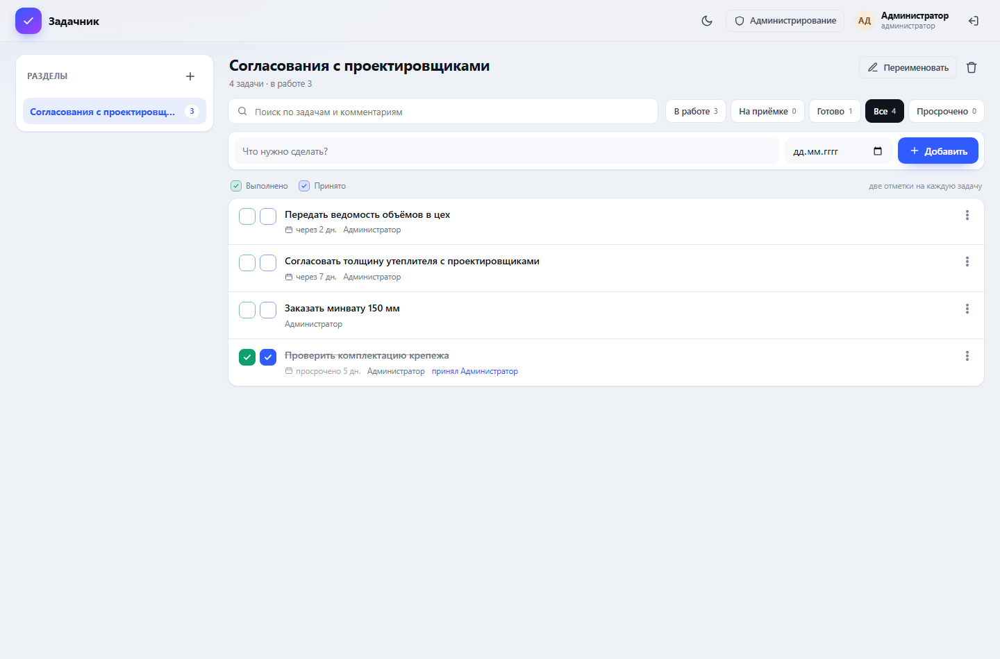
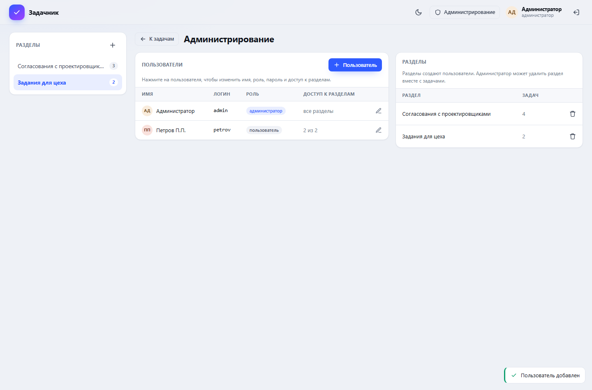

# Задачник

Простой командный задачник: задачи по разделам, две отметки об исполнении, сроки и комментарии. Всё хранится на сервере, поэтому задачи видны с компьютера, телефона и планшета. Администратор заводит пользователей и настраивает, кто какие разделы видит и может ли создавать и редактировать задачи.



## Возможности

- **Разделы** — «Согласования с проектировщиками», «Задания для цеха», «Закупки» и любые другие. Раздел может создать любой пользователь, автор сразу получает к нему полный доступ.
- **Задачи списком** — название, срок исполнения, комментарии.
- **Две отметки об исполнении** на каждую задачу:
  - **Выполнено** — исполнитель сделал работу;
  - **Принято** — ответственный проверил и принял результат.
  Отметки независимы: можно принять задачу, не отмечая выполнение, и наоборот.
- **Дата исполнения** — отдельное поле, просроченные задачи подсвечиваются.
- **Комментарии** — отдельное поле с историей сообщений: кто и когда написал.
- **Фильтры** — «В работе», «На приёмке», «Готово», «Все», «Просрочено», плюс поиск по задачам и комментариям.
- **Пользователи и права** — на каждый раздел настраивается отдельно: чтение, создание, редактирование.
- **Тема** — светлая, тёмная или как в системе; вёрстка адаптирована под телефон.



## Быстрый старт

Нужен [Node.js](https://nodejs.org) 18 или новее. Внешние зависимости не требуются.

```bash
node server.js
```

или двойной щелчок по `start.cmd` в Windows.

Сервер напишет в консоль адреса:

```
Локально:  http://localhost:3000
В сети:    http://192.168.100.249:3000
```

1. Откройте сайт — при первом запуске он попросит создать администратора (логин, имя, пароль).
2. Создайте разделы и задачи.
3. Заведите пользователей в разделе «Администрирование» и отметьте, что им разрешено.

## Доступ с других устройств

- Узнайте IP-адрес компьютера: `ipconfig` (строка «IPv4-адрес»).
- Откройте этот адрес с телефона: `http://IP:3000`. Устройства должны быть в одной сети (Wi-Fi).
- Если страница не открывается — разрешите порт в брандмауэре Windows: запустите `open-firewall.cmd` от имени администратора (один раз).

## Пользователи и права

В «Администрировании» администратор может:

- создать пользователя (логин, имя, пароль) и позже сменить пароль или отключить учётную запись;
- задать права на каждый раздел тремя галочками:

| Право | Что разрешает |
| --- | --- |
| **Чтение** | видеть раздел и его задачи, открывать карточку |
| **Создание** | добавлять новые задачи в раздел |
| **Правка** | менять задачи, отмечать галочки, писать комментарии, удалять задачи |

«Создание» и «правка» автоматически включают чтение. Администратор видит все разделы и может всё.

Раздел, созданный обычным пользователем, сразу доступен ему полностью; остальным — только после настройки прав администратором.

## Где хранятся данные

Всё лежит в одном файле на сервере:

```
data/db.json
```

Там пользователи (пароли — в виде scrypt-хешей), разделы, права, задачи и комментарии. Файл не попадает в git (см. `.gitignore`).

**Резервная копия:** остановите сервер и скопируйте `data/db.json` в надёжное место. Или запустите `backup.cmd` — он положит копию в папку `backups` с датой в имени.

**Перенос на другой компьютер:** скопируйте папку проекта вместе с `data/db.json`.

## Автозапуск при входе в Windows

Запустите `install-autostart.cmd` — задача «Zadachnik» будет стартовать при входе пользователя в систему. Удалить автозапуск: `schtasks /Delete /TN "Zadachnik" /F`.

## Публикация в интернете

Локальная сеть — самый простой вариант. Если нужен доступ извне, поставьте приложение на сервер (VPS) и обязательно включите HTTPS.

Docker:

```bash
docker build -t zadachnik .
docker run -d --name zadachnik -p 127.0.0.1:3000:3000 -v zadachnik-data:/data zadachnik
```

Caddy как обратный прокси с автоматическим сертификатом:

```
zadachi.example.ru {
    reverse_proxy 127.0.0.1:3000
}
```

Без HTTPS не выставляйте порт в интернет: пароль и сессионная cookie должны идти по шифрованному каналу.

## Безопасность

- Пароли хранятся как scrypt-хеши с индивидуальной солью.
- Сессия — случайный токен в cookie `HttpOnly`, `SameSite=Strict`, срок 30 дней.
- Все изменяющие запросы требуют заголовок `X-Requested-With: fetch` (защита от CSRF).
- Ограничение попыток входа: 20 неудач с одного IP за 15 минут.
- Права проверяются на сервере при каждом запросе, а не только в интерфейсе.
- В ответах API нет хешей паролей и токенов сессий.

## API (кратко)

| Метод | Путь | Назначение |
| --- | --- | --- |
| GET | `/api/me` | текущий пользователь и доступные разделы |
| POST | `/api/setup` | создать первого администратора |
| POST | `/api/login`, `/api/logout` | вход и выход |
| GET/POST | `/api/sections` | список и создание разделов |
| PATCH/DELETE | `/api/sections/:id` | переименовать / удалить раздел |
| GET/POST | `/api/sections/:id/tasks` | задачи раздела |
| PATCH/DELETE | `/api/tasks/:id` | изменить / удалить задачу |
| POST | `/api/tasks/:id/comments` | добавить комментарий |
| GET/POST | `/api/users` | пользователи (только администратор) |
| PATCH/DELETE | `/api/users/:id` | изменить / удалить пользователя |
| PUT | `/api/users/:id/permissions` | права пользователя на разделы |

## Тесты

```bash
npm test
```

`test/smoke.js` поднимает сервер на временной базе и проверяет первый запуск, разделы, задачи, отметки, комментарии, права доступа и защиту API.

## Структура

```
server.js              HTTP-сервер, API, авторизация, база
public/index.html      страница приложения
public/assets/app.js   интерфейс: список, карточка задачи, администрирование
public/assets/app.css  стили и темы
public/assets/api.js   клиент API
public/assets/util.js  вспомогательные функции
public/assets/overlay.js окна и уведомления
data/db.json           база данных (создаётся при первом запуске)
test/smoke.js          тесты API
start.cmd              запуск в Windows
open-firewall.cmd      разрешить порт 3000 в локальной сети
install-autostart.cmd  автозапуск при входе в Windows
backup.cmd             резервная копия базы
Dockerfile             запуск на сервере
```
